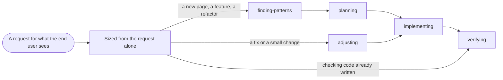
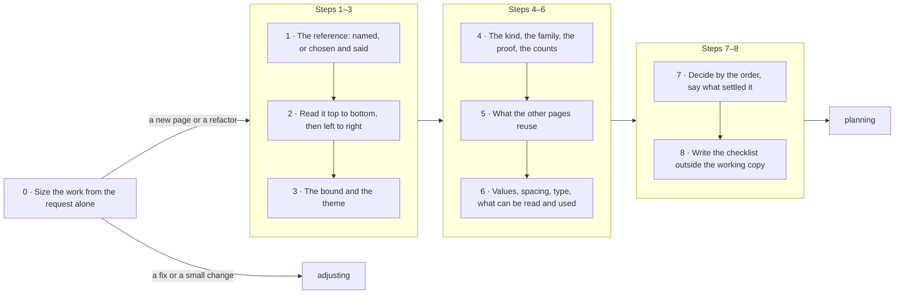
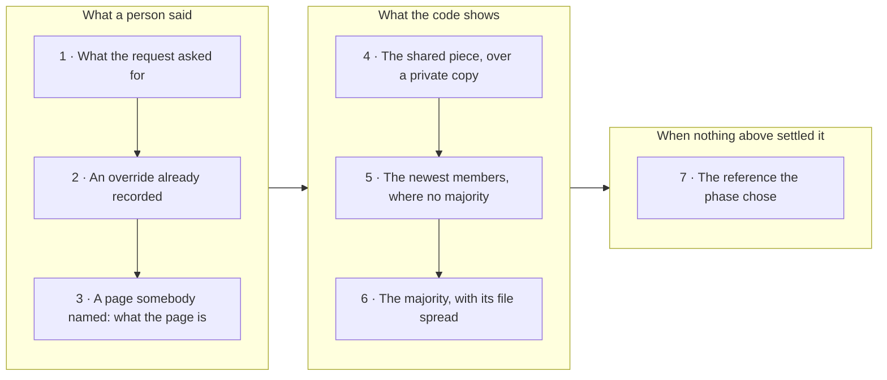
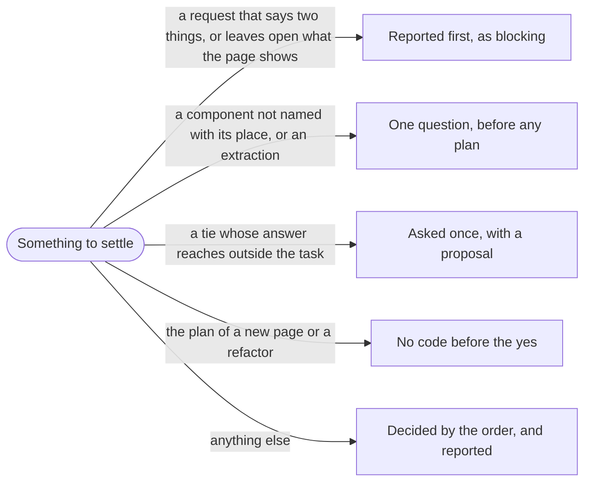
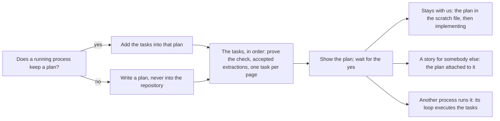
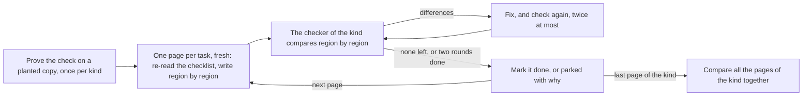
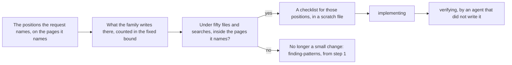

# How it works

What the skills do, drawn. The skills are the source; each diagram names the
skill it draws.

## The path of a request

The size is decided from the request alone, before any project file is opened
(`finding-patterns`, step 0). A new page, a feature, or a refactor of which
pieces pages are built from runs all four phases. A fix or a small change to
pages that exist runs `adjusting` in place of `finding-patterns` and `planning`,
and still ends in a check by an agent that did not write it. Checking code
already written is `verifying`, after `finding-patterns` where no checklist
exists yet. `design` reads a page's design, or agrees a new page's shape with
the person; `values`, `conventions` and `decisions` are invoked by the phases
when a step needs them; `accessibility` measures against a standard only when
asked or when the project states a requirement. Where another process already
keeps a spec or a plan, the phases add to it instead of writing a second one.

## finding-patterns

Nothing but the checklist is written while this phase runs. Before step 1 the
steps and the three phases after become a task list, each task naming the skill
or file its step opens, and none is marked done until those are invoked or
opened. The reference is the
page the request names, level 3 of the order, or, when nobody named one, the
page the phase chooses and says it chose, level 7. It is read holder by holder,
down into its children, including how a form is validated and how a failure is
shown. The family is counted within its bound, and every search is first run on
the reference to prove it can see. What the other pages import is used, never
rewritten, and values come through the theme. Where the project disagrees with
itself, the order below decides, and each decision carries the level that
settled it and its numbers. The checklist goes to a scratch file outside the
working copy, or into the plan or document of a process already running.

## The order of decisions

The first level that applies settles a position, and the decision is reported
with that level and its numbers (`decisions`, *The order*). The first three come
from a person: the request, an override a person gave, a page somebody named,
which settles what the page is and never whether to use a shared piece. Level 4
is searched as wide as the page can import from, so two of three pages
bypassing a shared piece do not outvote it, the named page's own copy included.
The newest members decide where a count has no majority, or where the project's
written rule agrees with them; more files outrank more occurrences. A piece
beside another that fills the same role on the same page is written the way that
one is, after levels 1 to 3 and before any count.

## What waits on a person

Three things wait on a person: the plan's yes, a question about new components
and extractions, and a tie whose answer reaches outside the task (`decisions`,
*When to ask anyway*). A request that says two things at one position, or leaves
open what the page must show, is reported first, as blocking, and only the
positions it touches wait on the answer. The question about components is asked
once, one line each: what is created, where it will live, which pages it
touches, and what a no means, which is the page written the way the project
writes it now. Where nobody can answer it, the page is written that way and the
question is reported. A proposal, such as a theme entry a value needs, is shown
with the plan and answered by its yes. A yes given in advance counts as the
plan's yes and settles that task only.

## planning

Every page task carries its checklist in the task itself, the reference's path,
what is particular to the reference and must not be copied, and the shared
pieces and theme values the page must use. The first task proves the check:
`verifying` is run on a scratch copy of the reference with one role written
differently, by an agent that will not check the pages; if the difference is not
reported, the work stops and the check is said to be blind for it. A page without a shape, from
a design, a reference page or a tree agreed in `design`, goes back to
`finding-patterns` before the plan is shown. A person's decision at the yes that
goes against what the order produced is recorded as an override, in their own
words. The phase ends in one of three ways, said in one line. A fix or a small
change has no plan and does not stop.

## implementing and verifying

The checker is one agent per kind of page, never the agent that wrote the page
and never the one shown the planted copy. It reads the checklist and the page
first, and the project only where they do not answer. It notes every difference
first, the uncertain ones included, then judges each by the order the page was
built from, and reports only what differs, with what the reference and the rest
of the project do instead. A difference the request asked for is not a
deviation. Every report names what the check could not see and the cost: no
differences never means the page is right. What a second round still reports is
listed in the checker's words, not fixed a third time. The final report names the
proof: what was planted, and whether it was caught.

## adjusting

A small change reads about ten project files and ten searches before
`implementing`, and about twenty-five of each for the whole change, the checks
included; each crossing is said when it happens, and past fifty it is no longer a
small change. It skips every position the change does not touch, the plan, and
the stop for a yes. It never skips the proof that a search can see, the order,
or the check by an agent that did not write the change, whose proof is one plant
at a changed position, once for the change. A new component in a page's own
files that the request did not name with its place is asked about first; one that would live
outside the pages it names sends the work to `finding-patterns`. The checklist
names the pages still writing a position the old way, and the change leaves them
as they are.
